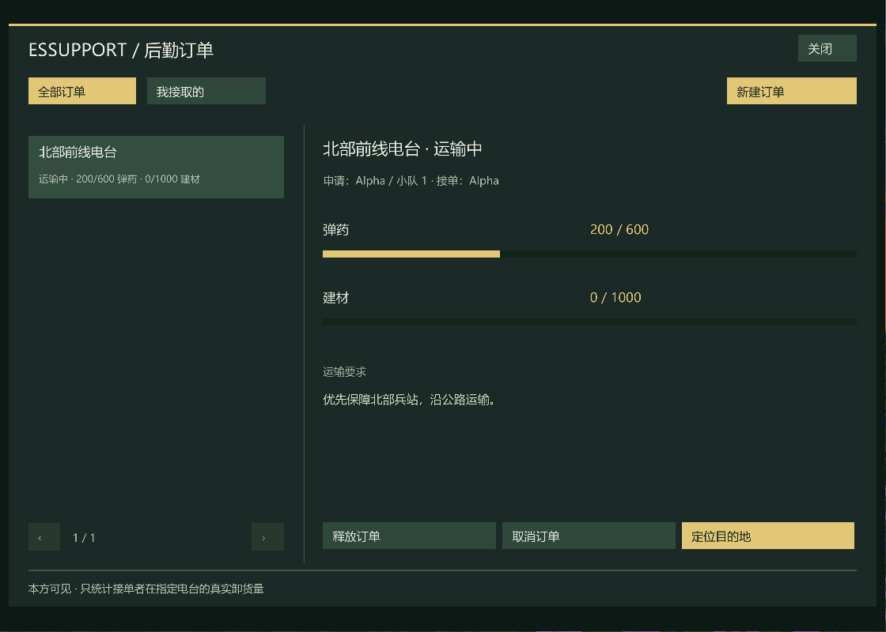

# EsSupport

为 **Minecraft 1.20.1 / Forge / Espetro** 提供独立的后勤订单系统。

队长填写补给需求，队员接单运输；在指定电台真实卸货后，弹药与建材进度自动累计。库存和载具装卸继续由 Espetro 管理。



## 安装

客户端和服务器均安装同版本 EsSupport。保留 Espetro 原有前置；客户端需要 **EsRadial 0.3.2+、ApricityUI 1.2.6**。EsPoints 为可选地图集成。

- 默认按 **O** 打开后勤订单，可在按键设置改键。
- 也可输入 `/essupport`，或点击 Espetro 部署界面右上角的“后勤订单”。
- 火力申请属于 Espetro 本体的独立功能；EsSupport 不包含火力审批或炮击逻辑。

## 订单流程

1. 战斗阶段，已部署的小队长或指挥官选择己方 Radio，填写弹药、建材数量和任务说明，发布订单。
2. 本方已部署、已加入小队的队员接取订单。每人同时只能接一单，同一 Radio 同时只能有一张有效订单。
3. 使用 Espetro 原有载具装卸，从主基地或其他 Radio 装货，到订单指定 Radio 卸货。
4. 只统计**接单者实际卸下的数量**，允许分批交付；两种物资均交足后自动完成。
5. 接单者或指挥官可以释放订单；申请人或指挥官可以取消。接单者离线或离队会重新开放订单，目的地 Radio 失效会取消。

“全部订单”和“我接取的”可筛选本方列表；详情提供交付进度和目的地地图。没有 EsPoints 时使用本局地图范围的坐标视图。敌方不能读取本方订单。

### 交付来源

在同一 Radio 装走再卸回，不会刷交付。Mod 启动或换局前，车内来源无法核实的旧物资不计入进度，请从基地或其他 Radio 重新装载；原有库存和正常装卸不受影响。

订单是**局内数据**：换战局清空，本局结束取消未完成订单，服务器重启不恢复。当前版本不提供跨局任务、奖励积分或自动驾驶运输。

## 服务端配置

首次启动后生成 `<世界>/serverconfig/essupport-server.toml`，修改后重启服务器。

| 项目 | 默认 | 含义 |
| --- | ---: | --- |
| maximumPerTeam | 48 | 每方保留订单上限，含历史 |
| maximumQuantity | 5000 | 每种物资单次申请上限 |
| createIntervalTicks | 200 | 同一玩家两次发布最小间隔 |
| supplyLifetimeTicks | 36000 | 订单有效期，默认 30 分钟 |

## 构建与测试

Java 17，Gradle Wrapper 8.5。将合法取得的依赖放入 `libs/espetro-local.jar`、`libs/esradial-local.jar`，再运行：

```sh
./gradlew :core:test :forge:build
```

只运行与 Minecraft 无关的核心测试，不需要依赖 Mod jar：

```sh
./gradlew -PcoreOnly :core:test
```

`core` 负责权限、接单状态、分批交付、货源跟踪、过期和换局；`forge` 负责网络、Espetro 装卸监听和 ApricityUI 字体界面。GitHub Actions 执行核心测试。

适配核对基线为 Espetro main `94dc39b1c2d60f62e55eefdf00852f62b38ac433`。附加 Mixin 监听 `VehicleSupplyActionPacket` 的四种实际装卸结果，无需改写 Espetro 库存。若上游改动目标方法签名，需同步更新适配。

验证详情见 [docs/verification.md](docs/verification.md)。
